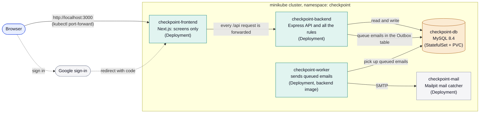
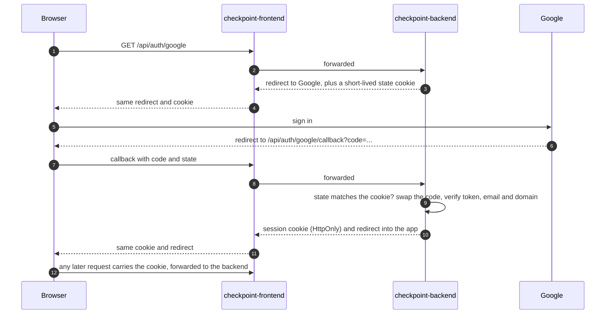
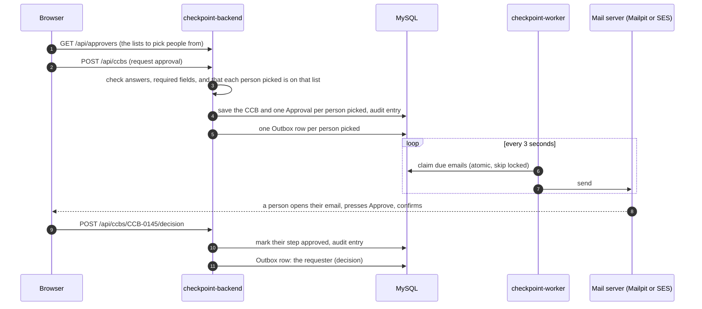

# Checkpoint architecture

How the system fits together, what each component does, and how it runs. The diagrams are Mermaid, so GitLab, GitHub and most editors draw them.

## 1. The big picture



Four ideas to hold on to:

1. **Frontend and backend are separate services in separate pods.** The frontend only draws screens. It has no database access and holds no secrets. The backend is the only service (with the worker) that touches the database.
2. **The browser still sees one address.** The frontend forwards every `/api/...` request to the backend (`frontend/src/app/api/[...path]/route.ts`). Cookies stay on that address and the Google redirect keeps working. The backend address is the `BACKEND_URL` setting, read when the frontend starts.
3. **Email goes through the database.** The backend writes an email into an `Outbox` table; the worker sends it and retries if the mail server is down. A restart or an outage cannot lose an email.
4. **MySQL keeps its data on a PersistentVolumeClaim.** There are no backups in the local setup; on EKS the Helm chart adds daily dumps to S3 and EBS snapshots (docs/EKS.md).

## 2. Local and production

| Piece | On minikube (now) | In production (later) |
|---|---|---|
| Frontend | `checkpoint-frontend` Deployment | Same image, 2 or more replicas, behind an ingress with TLS |
| Backend and worker | `checkpoint-backend` and `checkpoint-worker` Deployments | Same |
| MySQL | StatefulSet with a 2 GB volume | StatefulSet on an encrypted gp3 EBS volume, dumps to S3 and EBS snapshots (docs/EKS.md) |
| Email | Mailpit catches everything | **SES** through its SMTP endpoint (only settings change, see section 8) |
| Sign-in | Google, plus dev buttons (`APP_ENV=local`) | Google only, `APP_ENV` not `local` |
| Secrets | A plain Secret file | Vault or another secret manager |
| Access | `kubectl port-forward` | Ingress with a real hostname |

## 3. The components

| Kubernetes object | What it is | How it runs |
|---|---|---|
| `checkpoint-frontend` (Deployment, Service :3000) | Next.js: screens, plus the `/api` forwarder | `npm start`. Probe: `GET /healthz`, which does not call the backend, so a backend restart never restarts the screens. |
| `checkpoint-backend` (Deployment, Service :4000) | Express API. All CCB rules, sign-in, email queueing | Start-up steps run first: wait for the database, then create the tables and seed. Then `npm start`. Probe: `GET /api/health`, which runs a real `SELECT 1`. |
| `checkpoint-worker` (Deployment) | The background sender | Backend image, `npx tsx worker/index.ts`. Every 3 seconds it claims due emails from the Outbox, sends them, and records the result. |
| `checkpoint-db` (StatefulSet, Service, PVC) | MySQL 8.4 | Official image. Data lives on the volume claim `data-checkpoint-db-0`, kept even if the StatefulSet is deleted. Probe: a real query as the app user. |
| `checkpoint-mail` (Deployment, Service) | Mailpit | Accepts SMTP on 1025 and shows messages in a browser on 8025. |
| ConfigMap and Secret | Settings and passwords | Injected into the backend and worker as environment variables. The frontend gets only `BACKEND_URL`. |

**Two container images are built.** `checkpoint-frontend` (from `frontend/`) and `checkpoint-backend` (from `backend/`, used by both the API and the worker).

## 4. How it starts

1. `kubectl --context minikube apply -k deploy/k8s` creates everything (the helper script always names the context).
2. The database comes up and attaches its volume.
3. The backend pod runs two **init containers** before the API starts:
   - `wait-for-db` repeats `mysqladmin ping` until MySQL answers.
   - `schema-sync` runs `prisma migrate deploy` (applies the versioned migrations in `backend/prisma/migrations`; already applied ones are skipped, and Prisma takes a lock so several pods starting together is safe) and then `prisma/seed.ts` (loads the CCB types, the people in users.yaml, and samples if `SEED_SAMPLES=true`). A schema change is a new migration: `npm --prefix backend run db:new-migration`, then commit the generated SQL.
4. The API starts. Loading its settings first means a bad production setup, such as a missing `SESSION_SECRET`, stops it immediately with a clear message.
5. The worker waits for the database, then starts polling. The frontend starts on its own and needs nothing else.

## 5. The code

```
checkpoint/
  frontend/                       the screens (own package.json and Dockerfile)
    src/app/
      layout.tsx, globals.css     page frame, the whole design (colour tokens, buttons, cards)
      login/page.tsx              Sign in with Google (the only way in)
      healthz/route.ts            the pod's own probe
      api/[...path]/route.ts      forwards every /api request to the backend
      (app)/                      everything after sign-in (wrapped by Shell)
        page.tsx                    sends you to /ccb (there is no home page)
        ccb/page.tsx                All CCBs, with Type and Status dropdown filters
        ccb/new/page.tsx            New CCB: the five-step journey
        ccb/[code]/page.tsx         one CCB in full, with the approval chain
        ccb/calendar/page.tsx       release calendar
        ccb/approvers/page.tsx      who approves each step (admins can edit)
        rbac/page.tsx               Access Management: member / power user / admin per person
    src/components/, src/lib/     menu, theme, Dropdown and other UI pieces; API caller, hooks, formatting
  backend/                        the API and worker (own package.json and Dockerfile)
    src/
      index.ts                    starts Express, mounts the routes
      routes.ts                   every URL, one place
      config.ts                   reads every environment variable
      db.ts, http.ts, ratelimit.ts
      auth.ts                     sessions, Google sign-in, access checks
      templates.ts                the catalog: 21 CCB types, their questions and fields
      approvers.ts                reads and writes approvers.yaml (the approval matrix)
      ccb.ts                      ALL business logic for CCBs
      status.ts                   how status is worked out
      mail.ts, mail.templates.ts  the Outbox, and the email layouts
      schemas.ts                  what each request body must look like
    prisma/schema.prisma, seed.ts every table; catalog, upgrade of older data, demo data
    worker/index.ts               the email worker
    test/smoke.ts                 end-to-end checks
  deploy/k8s/                     Kubernetes files
  scripts/minikube.sh             helper commands
```

### The CCB catalog (`backend/src/templates.ts`)

21 types in 7 groups: General; Applications (Application Release, Configuration & Feature Flag, Application Scaling, Kubernetes); Network & edge (Cloudflare, Network & Load Balancer, Nginx); Data & messaging (Database, Cache, Kafka Topic, Data Pipeline, Storage & Backup); Infrastructure (Infrastructure, Instance Resize, Planned Downtime); Security & access (Security, Access Request); Operations (CI/CD Pipeline, Monitoring & Alerting, Third-party Integration). Each one has:

- **questions**: asked one at a time at the start. An answer can nudge the suggested risk. Some carry a short "heads up". **Every question ends with "Something else"**, added automatically, which asks the requester to describe it.
- **fields**: the details specific to that kind of change (shown under *Details* in the CCB and in the email).

Every type also gets the common fields: **tested in a lower environment** (Yes or No, and why not when No), **risk associated with the change**, **systems affected** and **rollback plan**. General itself asks for a **Description** and an optional **JIRA or MR link**. CCBs filed before this asked for reason, impact and a QA plan; those answers are still shown on them. To add a type, add an entry and re-seed; no other code changes.

### Which kinds of CCB can be filed

Only **General** for now. `ENABLED_CCB_TYPES` (in `deploy/k8s/configmap.yaml`) lists the kinds that can be filed: `general` by default, a comma-separated list such as `general,database`, or `all`. A kind that is switched off cannot be planned or filed, and does not appear in the form; CCBs of that kind that already exist still open and list normally. The form has Title, Business unit (Lenskart (India/International), Owndays, Ajna Lens), Requestor email (filled in from the signed-in user and editable), Environment (Production, Preprod, Staging, Alpha) and the change window. There is no change type and no CAB meeting.

### Database servers in the Database CCB

A Database CCB asks which servers it is about, with drop-downs that read two YAML files, `deploy/k8s/mysql-inventory.yaml` and `deploy/k8s/mongodb-inventory.yaml` (built from your MySQL and MongoDB inventory sheets):

- **MySQL:** choose a type (**Master**, **Slave**, **Proxy**, **Standalone**, **Other**), optionally a group (SCM/WEB CORE, NEXS CORE, ...), and the IPs of that type appear to pick from.
- **MongoDB:** choose a cluster (Bridge Prod, Juno Prod, ...), then a role in it (Primary, Secondary, Router, Shard 1 Primary, ...), and its IPs appear.
- **Any other engine, or an IP that is not listed,** is typed and added with Enter. Several servers can be added, and "Add all" adds everything currently listed.

The files are read-only here and re-read when they change. To update them, edit the file and run `./scripts/minikube.sh apply`. The chosen servers are saved on the CCB, one per line.

### Who is asked: the approval matrix

There are three kinds of people on a CCB:

| Kind | Lists |
|---|---|
| **Approvers** | **LK Tech**, split into the service teams (POS, Juno, CES, SCM/NEXS, Puno, JJ, Analytics, Cosmos, LK Platform, QMS), and **LK Platform** (Pratiti Basu, Vikram Gaur) |
| **Sign-offs** | **Security**, **QA** |
| **Executioners** | **DevOps**, **DataOps** |

1. **Who the people are** is the approval matrix, kept in the database (table `Setting`, id `approvers`) so every backend replica sees the same list. The project's copy, `deploy/k8s/approvers.yaml`, is only the starting copy: the first start copies it in. **CCB, Approval matrix** (admins only) shows it, grouped by kind, and is where it changes. Each backend re-reads it every 10 seconds. `approvers-export` saves the live matrix back into the project; `approvers-reset` replaces it with the project's copy (both in `scripts/minikube.sh` and `scripts/eks.sh`). Stored text that is broken is refused, and the last good copy stays in use.
   - **A name with no email is listed only.** It shows "No email present", is never emailed, and cannot be picked.
2. **Who a CCB goes to** is picked by the person filing it, person by person:
   - **Service belongs to**: one or more rows of *team* and *approvers from that team* (several can be picked). **+ Add another team** adds a row. At least one team with at least one approver is required. Choosing **Other** lets you type a team name that is not listed; it takes exactly one approver, whose lenskart.com or lenskart.in email you type.
   - **Security sign-off**, **QA sign-off**, **DevOps executioners** and **DataOps executioners**: each a multi-select from its list, each optional.
   - Only people listed (with an email) for that team or list are accepted; the backend checks this again.
3. **The risk level** (Low, Medium, High) is always asked. Nothing is suggested for General.

**Everyone is asked at the same time.** Each person picked gets one step on the CCB (for example "LK Tech · POS approver", "QA sign-off", "DevOps executioner") and is emailed when the CCB is filed. Each answers for their own step in any order. The CCB page shows the steps grouped as Approvers, Sign-offs and Executioners, each Pending, Approved or Rejected, and the CCB is **Cleared** when every step is approved. One rejection stops the change. A person with several steps answers each one separately under **Your steps**, and each email's buttons are for that email's step only.

**Analysis comes after filing.** The CCB page has an **Analysis** section with one entry each for DevOps, DataOps and QA. Anyone listed for that team in the approval matrix can add it or update it (there is one per team); everyone else can read it. Saving asks first and is recorded in the audit trail.

### Access Management

What a person may do in Checkpoint, separate from who approves: **Member** (file and manage CCBs, but not delete them), **Power user** (also delete CCBs) and **Admin** (also edit the approval matrix and change access). The page is at the top right (**Access Management**). Everyone signed in can see the list; only an admin can change it, add a person, or edit approvers. An admin can't change their own access, and there is always at least one admin.

**Only company emails** (`lenskart.com`, `lenskart.in`) can sign in, be added, or be an approver. **Anyone who signs in with Google, or signs up, is added to the list automatically** as a Member (or Admin if listed in `BOOTSTRAP_ADMINS`). People can also be preloaded from `deploy/k8s/users.yaml`: at every start, anyone listed who is not in Checkpoint yet is created with the access written there, and anyone already there is left alone, so changes made in the UI are never undone by the file. If the file is missing or broken, only the first admin, `dhruv.sharma@lenskart.com`, is created. `./scripts/minikube.sh users-export` saves who is in Checkpoint now into the file.

### Sample CCBs

**Off by default.** A new database holds no CCBs. Only when `SEED_SAMPLES` is exactly `"true"` does the first start file 13 sample CCBs (as the first admin) so the screens have something to show: different types, risks, environments, and every status. They are loaded once, and the list is in `backend/prisma/samples.ts`.

To remove samples that were loaded earlier: `./scripts/minikube.sh remove-samples` or `./scripts/eks.sh remove-samples <env>`. It lists them first and removes them only after you type `yes`. A CCB counts as a sample only if both its type and its title match the list, so CCBs people filed are never touched. Their audit trail stays, as when a CCB is deleted in the app, and if no CCB is left the numbering starts again from the beginning.

### Asking before changing anything

Nothing that changes something runs on a single click. A confirmation box (cancel is focused, so Enter does not confirm) comes before: approving, rejecting (reason first), sending a reminder, marking rolled out or rolled back, filing a CCB, deleting a CCB, changing someone's access, adding a person, and saving approvers. The new-CCB form is a single page; leaving it with anything entered asks too: Back, a trackpad swipe, a menu link or closing the tab all ask whether to discard it.

### The server layer, file by file

| File | What it does |
|---|---|
| `config.ts` | The only place that reads `process.env`. `APP_ENV=local` turns on developer conveniences; anything else behaves as production. In production it refuses to start with the default session secret. |
| `auth.ts` | **Session:** a signed token in an HttpOnly cookie holding only the user id. Access is read from the database on every request, so a change applies immediately. **Google:** exchanges the code, verifies the ID token, requires a verified email and an allowed domain. **Dev login:** only when `APP_ENV=local`. |
| `ccb.ts` | catalog, create (checks every person picked against the approval matrix), list, get, decide, implementation, comment, remind, analysis, calendar, dashboard. |
| `approvers.ts` | Reads the approval matrix, maps old names (Development, Platform) to new ones, labels each step ("LK Tech · POS approver"), and saves edits from the UI. |
| `status.ts` | Any rejected approval means Rejected; all approved means Cleared; rolled out or rolled back after that; otherwise Awaiting. Status is **never stored**, it is worked out each time. |
| `mail.ts` | `enqueue()` writes a row. `processOutbox()` claims due rows with a single atomic statement (safe with several workers), sends them, and on failure retries after 1, 5, 30, 120 and 720 minutes, then marks the email `FAILED`. |
| `mail.templates.ts` | The emails (below). |

### The emails

An approval request shows, in order: the header, what is needed (for example "DEVOPS EXECUTIONER"), the title and risk, the **steps** with the person on each (approved / you / pending), the business unit, the team the service belongs to, requester, requestor email (when it differs) and change window, then the **Details**: description, JIRA or MR link, the template details, tested in a lower environment (and why not), systems affected and rollback plan, and finally **Approve** and **Reject** buttons.

The buttons open the change in Checkpoint with a confirmation (`/ccb/<code>?decide=approve&step=<step id>` or `reject`). They do not decide on their own: mail scanners open links, and a one-click decision from a link would let them approve changes.

Other emails: a reminder (same layout) and the decision notice to the requester.

### The API routes (`backend/src/routes.ts`)

| Route | Purpose |
|---|---|
| `GET /api/health` | Probe for Kubernetes (public) |
| `GET /api/auth/config` | Which sign-in options to show (public) |
| `GET /api/auth/google`, `/google/callback` | The two steps of Google sign-in (public) |
| `POST /api/auth/dev-login` | Local only |
| `GET /api/auth/me`, `POST /api/auth/logout` | Who am I, sign out |
| `GET /api/templates` | The catalog: types with questions and fields, common fields, older fields, business units, environments. Each type says whether it can be filed |
| `GET /api/dashboard` | The count of changes waiting on you, for the badge in the menu |
| `GET /api/calendar?from=&to=` | Releases in a date range |
| `GET, POST /api/ccbs` | List (search with `q`), file a new CCB |
| `GET /api/ccbs/:code` | One CCB with its analysis, comments and audit trail |
| `POST /api/ccbs/:code/decision` | Approve or reject (only the person whose step is open) |
| `POST /api/ccbs/:code/implementation` | Rolled out or rolled back |
| `POST /api/ccbs/:code/comments`, `/remind` | Discussion, reminder for one step |
| `PUT /api/ccbs/:code/analysis` | Add or update the DevOps, DataOps or QA analysis (people listed for that team) |
| `GET /api/me` | The signed-in person's own details |
| `GET /api/approvers`, `PUT /api/approvers` | The approval matrix; save changes (admins only) |
| `GET /api/rbac` | Everyone's access, and which steps they approve |
| `PATCH /api/rbac/users/:id`, `POST /api/rbac/users` | Change someone's access, add a person (admins only) |
| `DELETE /api/ccbs/:code` | Delete a CCB (power users and admins) |

Every route except the public ones requires a signed-in user.

### The data model

| Table | Holds |
|---|---|
| `User` | email, name, **access** (member, power or admin). Who approves what is not stored here: it is the approvers file |
| `Template` | one row per CCB type, copied from `templates.ts` by the seed |
| `Ccb` | code, type, title, risk, **change window start and end** (UTC), business unit, requestor email, the teams the service belongs to, answers as JSON, whether it was rolled out |
| `Approval` | one row per person asked: role, service team (for LK Tech), the person's name and email, **stage** (order), label, pending/approved/rejected, who, when, note |
| `Analysis` | the DevOps, DataOps or QA analysis on a CCB: one per team, who wrote it, when |
| `Comment`, `AuditLog` | discussion, every action (only ever added to) |
| `Outbox` | emails waiting to be sent, with attempts, next try and last error |
| `Counter` | next number for `CCB-0145` and `DT-15162` (Database CCBs use the `DT-` series) |

## 6. Sign-in

**Google is the only way to sign in, and the only way to become a user.** The first time someone signs in with a `@lenskart.com` or `@lenskart.in` Google account, they are added as a new user automatically (a Member, or an Admin if listed in `BOOTSTRAP_ADMINS`). There is no sign-up form and no password. An admin can also add a person ahead of time under Access Management. For local work without Google credentials, the sign-in page shows a small **Local development only** button while `APP_ENV` is `local`.



## 7. Filing a CCB and who is asked



Deciding finds the steps that are **pending and that you are listed for** (or the one step named in the request). If none, you get a 403. A rejection needs a reason and stops the change. When the last pending step approves, the CCB becomes **Cleared**.

## 8. Email: Mailpit now, SES later

The worker uses plain SMTP, so switching to SES is a **settings change only**. In `configmap.yaml` and the secret:

```
SMTP_HOST=email-smtp.<region>.amazonaws.com
SMTP_PORT=587
SMTP_TLS=true
SMTP_USER=<SES SMTP user>        (secret)
SMTP_PASS=<SES SMTP password>    (secret)
MAIL_FROM=Checkpoint <an address on a domain verified in SES>
```

Production also needs the sending domain verified in SES (SPF, DKIM) and the account moved out of the SES sandbox. This has **not** been tested against SES.

## 9. What is not production ready yet

- Tables are created with `prisma db push`. Before production, switch to committed migrations.
- There are **no backups**. The local database lives on a volume only. Add scheduled backups (for example to S3) before production.
- Secrets are plain local values. Use Vault.
- One replica of each service and one database pod. Production needs high availability.
- Rate limiting is per pod and in memory, and keys on `X-Forwarded-For`. Without an ingress that sets it, every sign-in attempt shares one limit. Add limits at the ingress too.
- Approvers are found by role, not by system. The "system owner" is recorded and shown but does not itself approve.
- **Not run by the person who wrote this change:** the Docker builds, the type check, the cluster, the screens in a browser, and real Google sign-in or SES. See the list in the hand-over notes.
