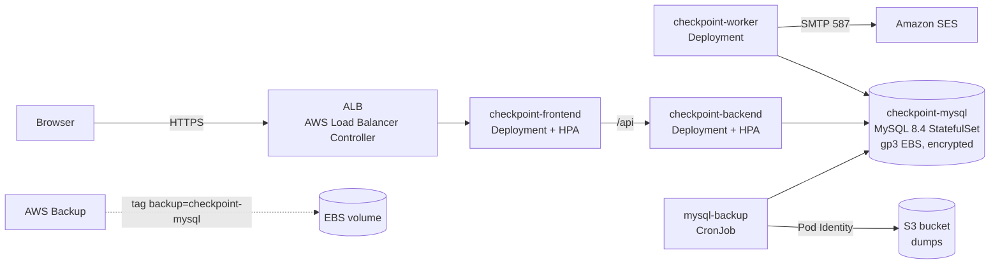

# Checkpoint on AWS EKS

How Checkpoint runs on `lk-tech-infra-02-eks` (account 964059510816, ap-south-1, Kubernetes 1.37), in two namespaces:
**devx-stg** (staging) and **devx-prod** (production). Everything is in this repository:

| What | Where |
|---|---|
| Helm chart | [`deploy/helm/checkpoint`](../deploy/helm/checkpoint) with `values.yaml`, `values-stg.yaml`, `values-prod.yaml` |
| Karpenter node pool | [`deploy/karpenter/devx-nodepool.yaml`](../deploy/karpenter/devx-nodepool.yaml) |
| Build, push, deploy helper | [`scripts/eks.sh`](../scripts/eks.sh) (`./scripts/eks.sh help`) |
| Local checks (Docker only) | [`scripts/check.sh`](../scripts/check.sh): backend on MySQL 8.4, frontend build, Helm lint and render |

`scripts/eks.sh` passes the cluster ARN, account and region on every `kubectl`, `helm` and `aws` call, so the current
kubectl context does not matter. Anything that changes `devx-prod` asks you to type `prod` first.

## 1. What runs



| Part | Kind | Scaling | Notes |
|---|---|---|---|
| frontend | Deployment, Service, HPA, PDB | 2 to 6 pods on CPU (stg 1 to 3) | Next.js. No secrets, no database. Probes `/healthz`. |
| backend | Deployment, Service, HPA, PDB | 2 to 8 pods on CPU (stg 1 to 3) | Express API. An init container runs `prisma migrate deploy` and the seed before the API starts. Readiness `/api/health` (checks the database), liveness `/api/live` (does not, so a database blip does not restart every pod). |
| worker | Deployment | 1 (more is safe) | Sends queued email. Several workers never send the same email (`SELECT … FOR UPDATE SKIP LOCKED`). |
| mysql | StatefulSet, headless Service, NetworkPolicy | 1 | MySQL 8.4 on an encrypted gp3 volume (`reclaimPolicy: Retain`). Binary logs kept 7 days. Annotated `karpenter.sh/do-not-disrupt` so consolidation never moves it. Only backend, worker and backup pods may connect. |
| mysql-backup | CronJob | daily (stg), every 6 h (prod) | `mysqldump --single-transaction` to S3. |
| Ingress | `alb` class | | One host per environment, HTTPS with an ACM certificate. |

Every app pod runs as a non-root user with no privilege escalation, all Linux capabilities dropped, the default seccomp
profile and no service-account token, which meets the Pod Security "restricted" level. Pods spread across zones and
nodes. Rolling updates keep every old pod until a new one is ready.

### What changed in the app for this

- **PostgreSQL to MySQL 8.4.** Prisma now uses MySQL. Arrays became JSON and long text became TEXT. The outbox claim
  became a two-step `FOR UPDATE SKIP LOCKED` (MySQL has no `RETURNING`).
- **Versioned migrations** in `backend/prisma/migrations` instead of `db push`. Production schema changes are SQL
  files that are reviewed, committed and applied in order. A change is made with `npm --prefix backend run db:new-migration`.
  `scripts/check.sh` fails if the schema and the migrations differ.
- **The approval matrix moved into the database** (table `Setting`). A file on a ReadWriteOnce EBS volume can only be
  mounted by pods on one node, which would block scaling the backend. Every replica now reads the same row and refreshes
  it every 10 seconds. `deploy/k8s/approvers.yaml` is the starting copy only.
- **Production mode** (`APP_ENV=production`): no developer sign-in, Secure cookies, Google sign-in only. The app refuses to
  start without a real `SESSION_SECRET`.

## 2. What the cluster needs (check with `./scripts/eks.sh preflight`)

From the console: the EBS CSI driver (IRSA), the Pod Identity Agent, VPC CNI, CoreDNS and kube-proxy are installed. There
are no managed node groups and no Fargate profiles, yet there are 7 nodes, so Karpenter is most likely already running.

| Needed | Why | Status |
|---|---|---|
| EBS CSI driver | the MySQL volume | installed |
| EKS Pod Identity Agent | S3 access for the backup job | installed |
| Karpenter (v1 API) | the nodes | **to confirm** (preflight lists NodePools) |
| metrics-server | the HPAs scale on CPU | **to confirm**; if missing: `aws eks create-addon --cluster-name lk-tech-infra-02-eks --addon-name metrics-server` |
| AWS Load Balancer Controller | the `alb` Ingress | **to confirm**; not an EKS add-on, usually installed with Helm |
| An ACM certificate | HTTPS for both hosts | **needed** |
| VPC CNI network policy (optional) | enforces the MySQL NetworkPolicy | off by default; `enableNetworkPolicy: "true"` in the VPC CNI add-on configuration |

## 3. Steps

You need `aws` (signed in to 964059510816), `kubectl`, `helm` 3.14+ (`brew install helm`) and Docker with buildx.

```bash
# 0. Check everything locally first (Docker only, no cluster)
./scripts/check.sh

# 1. What the cluster has
./scripts/eks.sh preflight

# 2. Nodes: one Karpenter pool for devx (cluster admin, once). Fill in the 3 CHANGE-ME values first, from:
kubectl --context arn:aws:eks:ap-south-1:964059510816:cluster/lk-tech-infra-02-eks get ec2nodeclass -o yaml
kubectl --context arn:aws:eks:ap-south-1:964059510816:cluster/lk-tech-infra-02-eks apply -f deploy/karpenter/devx-nodepool.yaml
#    then in values-stg.yaml and values-prod.yaml:   nodeSelector: { karpenter.sh/nodepool: devx }

# 3. Image repositories (once), then build and push both images for amd64 and arm64
./scripts/eks.sh ecr
./scripts/eks.sh build                       # prints the tag, e.g. 20261104-1530

# 4. Namespaces (once)
./scripts/eks.sh namespaces                  # devx-stg and devx-prod, Pod Security baseline enforced, restricted warned

# 5. Backup bucket (once, see section 5), then the backup job's access, per environment
BACKUP_BUCKET=lk-devx-checkpoint-backups ./scripts/eks.sh backup-access stg

# 6. Secrets, per environment (asks for the Google and SES values; generates the database passwords and session secret)
./scripts/eks.sh secrets stg

# 7. Hostname, certificate and bucket in deploy/helm/checkpoint/values-stg.yaml: webUrl, ingress.host,
#    ingress.annotations."alb.ingress.kubernetes.io/certificate-arn", backup.bucket

# 8. Deploy, then check
./scripts/eks.sh deploy stg 20261104-1530
./scripts/eks.sh status stg
./scripts/eks.sh backup-now stg              # a first backup, and proof that S3 access works

# 9. DNS: point the host at the ALB (kubectl get ingress -n devx-stg shows its address), e.g. a Route 53 alias record

# 10. Production: the same steps 5 to 9 with prod, after staging has been tested
```

Upgrades are step 3 (`build`) then step 8 (`deploy <env> <new tag>`). Migrations run on their own. A failed upgrade is
rolled back by Helm (`--atomic`); `./scripts/eks.sh rollback <env>` goes back by hand. Image tags are immutable in ECR,
so a tag always means the same build.

## 4. Google sign-in (Lenskart SSO)

1. In Google Cloud Console, in the Lenskart organization: **APIs & Services → OAuth consent screen**, user type
   **Internal** (only Lenskart Workspace accounts can sign in).
2. **Credentials → Create credentials → OAuth client ID**, type **Web application**. Authorized redirect URIs:
   - `https://<staging host>/api/auth/google/callback`
   - `https://<production host>/api/auth/google/callback`
3. Give the client ID and secret to `./scripts/eks.sh secrets <env>` (or patch them into `checkpoint-secrets` later and
   restart the backend: `kubectl -n devx-stg rollout restart deploy/checkpoint-backend`).

The app also checks the email domain (`lenskart.com`, `lenskart.in`) and that Google verified the email.

**Until the OAuth client exists, staging signs in with a developer button.** `values-stg.yaml` sets `app.env: local` and
`devLogin: "true"`, so the login page shows a small "Local development only" button that accepts any allowed-domain
address. Cookies stay Secure. Remove those two lines and redeploy when the client is in place; the defaults are
production. The chart refuses `app.env: local` in any namespace whose name contains "prod", so this cannot reach
`devx-prod` by accident. The first sign-in creates the person as a Member. `BOOTSTRAP_ADMINS` (in the values) become
Admin.

Because that button is a real bypass, staging is only reachable through Cloudflare: an Access policy (email
verification for the team) sits in front of `https://checkpoint.preprod.lenskart.com`, and the ALB's `inbound-cidrs` allow
only Cloudflare's IPv4 ranges, so the ALB's own DNS name is not a way around it. Two consequences when debugging: an
ALB that suddenly returns no response is often a stale Cloudflare range list, and direct access with `curl` has to go
through `kubectl port-forward`, not the ALB.

## 4a. Sign-in through the company IdP (OpenID Connect)

Lenskart's IdP is not Google, so sign-in goes through a standard OIDC client. The code reads the provider's discovery
document, so nothing has to change when the provider does.

**What the app needs**, set in `values-<env>.yaml` and the cluster secret:

| Setting | Where | Example |
|---|---|---|
| `app.oidc.issuer` | values | staging: `https://idp.lenskart.com` |
| `app.oidc.discoveryUrl` | values, only if the document is not at `<issuer>/.well-known/openid-configuration` | |
| `app.oidc.emailClaim` | values, if the address is not in `email` (often `preferred_username`) | |
| `OIDC_CLIENT_ID`, `OIDC_CLIENT_SECRET` | secret | `kubectl -n devx-stg patch secret checkpoint-secrets -p '{"stringData":{"OIDC_CLIENT_ID":"...","OIDC_CLIENT_SECRET":"..."}}'` |

**What the IdP side needs**: a confidential client using the authorization-code flow (PKCE is sent; set
`app.oidc.pkce: "false"` if the provider rejects it), with this redirect URI registered per environment:

```
https://<host>/api/auth/oidc/callback
```

**The claim `email_verified`.** Many in-house providers do not send it. Checkpoint refuses only an explicit
`email_verified: false`, which is what `app.oidc.requireVerified: "true"` means. The company domain check
(`ALLOWED_EMAIL_DOMAINS`) applies to this path exactly as it does to Google.

**Turning it on**: put the issuer in the values, patch the secret, redeploy. The login page shows the button as soon as
`OIDC_ISSUER`, `OIDC_CLIENT_ID` and `OIDC_CLIENT_SECRET` are all present, and the Google button only if the Google
credentials are set. With both set, both buttons appear; staging's developer button stays behind Cloudflare Access.

## 5. Backups

There are two layers, so losing one still leaves the other.

**1. Logical dumps to S3** (the CronJob in the chart). Each one is `mysqldump --single-transaction` (consistent, no
locks), gzipped, checked, and uploaded with server-side encryption to
`s3://<bucket>/checkpoint/<namespace>/YYYY/MM/DD/checkpoint-<time>.sql.gz`. The job's role may only write under its own
namespace's folder; it cannot read or delete. Create the bucket once:

```bash
B=lk-devx-checkpoint-backups
aws s3api create-bucket --bucket $B --region ap-south-1 --create-bucket-configuration LocationConstraint=ap-south-1
aws s3api put-public-access-block --bucket $B --public-access-block-configuration BlockPublicAcls=true,IgnorePublicAcls=true,BlockPublicPolicy=true,RestrictPublicBuckets=true
aws s3api put-bucket-versioning --bucket $B --versioning-configuration Status=Enabled
aws s3api put-bucket-encryption --bucket $B --server-side-encryption-configuration '{"Rules":[{"ApplyServerSideEncryptionByDefault":{"SSEAlgorithm":"AES256"}}]}'
# Keep staging dumps 14 days, production 35 days (then Glacier for a year)
aws s3api put-bucket-lifecycle-configuration --bucket $B --lifecycle-configuration '{"Rules":[
 {"ID":"stg","Status":"Enabled","Filter":{"Prefix":"checkpoint/devx-stg/"},"Expiration":{"Days":14},"NoncurrentVersionExpiration":{"NoncurrentDays":7}},
 {"ID":"prod","Status":"Enabled","Filter":{"Prefix":"checkpoint/devx-prod/"},"Transitions":[{"Days":35,"StorageClass":"GLACIER"}],"Expiration":{"Days":400},"NoncurrentVersionExpiration":{"NoncurrentDays":35}}]}'
```

**2. EBS snapshots with AWS Backup.** The chart's StorageClass tags the MySQL volume `backup=checkpoint-mysql`. Create a
plan that selects that tag. Daily snapshots, kept 14 days, are enough for staging. For production, keep them 35 days,
and you can copy them to a second region if you want.

```bash
aws backup create-backup-vault --backup-vault-name checkpoint
aws backup create-backup-plan --backup-plan '{"BackupPlanName":"checkpoint-mysql","Rules":[{"RuleName":"daily","TargetBackupVaultName":"checkpoint","ScheduleExpression":"cron(0 21 * * ? *)","Lifecycle":{"DeleteAfterDays":35}}]}'
aws backup create-backup-selection --backup-plan-id <plan id> --backup-selection '{"SelectionName":"checkpoint-volumes","IamRoleArn":"arn:aws:iam::964059510816:role/AWSBackupDefaultServiceRole","ListOfTags":[{"ConditionType":"STRINGEQUALS","ConditionKey":"backup","ConditionValue":"checkpoint-mysql"}]}'
```

Use the ARN from `aws iam get-role --role-name AWSBackupDefaultServiceRole --query Role.Arn --output text`. A
role created in the console lives under `role/service-role/`, one created with `aws iam create-role` under `role/`;
the selection only accepts the exact ARN. Add `{"ConditionKey":"env","ConditionValue":"devx-stg"}` (or `devx-prod`)
to the tag list to keep each environment's plan to its own volume.

**Restore from a dump** (tested on staging first, every quarter):

```bash
CTX=arn:aws:eks:ap-south-1:964059510816:cluster/lk-tech-infra-02-eks; NS=devx-stg
aws s3 cp s3://lk-devx-checkpoint-backups/checkpoint/$NS/2026/11/04/checkpoint-<time>.sql.gz /tmp/restore.sql.gz
kubectl --context $CTX -n $NS scale deploy/checkpoint-backend deploy/checkpoint-worker --replicas=0
gunzip -c /tmp/restore.sql.gz | kubectl --context $CTX -n $NS exec -i statefulset/checkpoint-mysql -- sh -c 'mysql -uroot -p"$MYSQL_ROOT_PASSWORD"'
kubectl --context $CTX -n $NS scale deploy/checkpoint-backend --replicas=2 && kubectl --context $CTX -n $NS scale deploy/checkpoint-worker --replicas=1
```

To recover to a point between dumps, replay the binary logs (kept 7 days on the volume) after the restore with
`mysqlbinlog --start-datetime=…`. To restore from an EBS snapshot, create a volume from it in the same zone, bind it with a
PersistentVolume of the StorageClass, and point the StatefulSet's claim at it.

**Targets:** at most 6 hours of data lost in production (1 day in staging), or minutes with the binary logs. A restore takes
under 30 minutes at today's size.

## 6. Mail (Amazon SES)

The chart points the app at `email-smtp.ap-south-1.amazonaws.com:587` with TLS. You need:
- `lenskart.com` (or the sending subdomain) verified in SES in ap-south-1, with DKIM records published.
- SES moved out of the sandbox (in the sandbox it only sends to verified addresses).
- SMTP credentials (SES console, SMTP settings). They go into `checkpoint-secrets` as `SMTP_USER` and `SMTP_PASS`.

Until those exist, CCBs still file and every email waits in the outbox (retried, then marked failed), so nothing is lost.

## 7. Production readiness

| Area | State |
|---|---|
| Secrets | Not in Git or the chart. They are created in the cluster by `eks.sh secrets`, and database passwords are generated. Next step: AWS Secrets Manager with the External Secrets Operator, if the cluster has it. |
| Sign-in | Google only, company domains only, verified emails only, Secure HttpOnly cookies, 8-hour sessions. |
| Data | Encrypted volume, kept when deleted, two backup layers, binary logs, versioned migrations. |
| Availability | 2+ pods for each stateless part across zones, PDBs, zero-downtime rolling updates, readiness gates on the database. MySQL is a single pod: a node failure means a few minutes of downtime while the volume reattaches (the zone stays the same). |
| Scaling | HPAs on CPU for the frontend and backend. Karpenter adds and removes nodes. The worker can be scaled. |
| Security | Non-root pods, no privilege escalation, no capabilities, seccomp default, no service-account tokens, MySQL NetworkPolicy, IMDSv2 on Karpenter nodes with hop limit 1, image scanning on push, immutable tags. |
| Observability | Logs to stdout. Next step: ship them to the cluster's log stack, and alert on backup-job failures (`kube_job_status_failed{job_name=~"checkpoint-mysql-backup.*"}`). |

Known limits that are acceptable for now:
- The in-cluster MySQL has no replica. If production needs failover, move to Amazon RDS for MySQL Multi-AZ. The chart then
  only needs a different `DATABASE_URL`.
- The approval-matrix cache can be up to 10 seconds stale on other replicas after an edit.

## 8. Still to confirm

1. **Hostnames** for staging and production, and the **ACM certificate** ARN. Also whether the ALB is internet-facing or internal (VPN only).
2. Whether **Karpenter**, **metrics-server** and the **AWS Load Balancer Controller** are installed (`preflight` shows this). For
   the NodePool, the node IAM role name and the discovery tag on the subnets and security groups.
3. The **S3 bucket** name for backups, and how long to keep backups.
4. The **Google OAuth client** (who owns the Google Cloud project) and the **SES** sending domain and SMTP credentials.
5. In-cluster MySQL (this plan) or **RDS for MySQL**. The request asked for a PVC on EBS; RDS would add Multi-AZ failover
   and managed backups, at extra cost.
